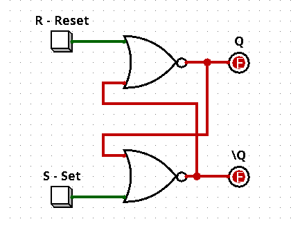
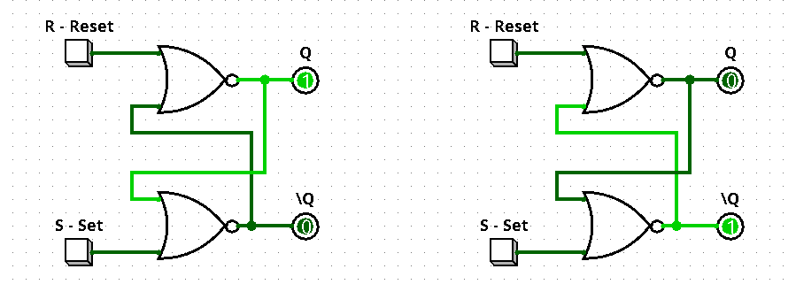
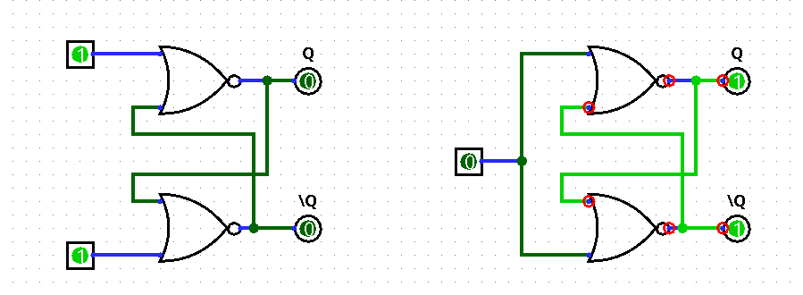
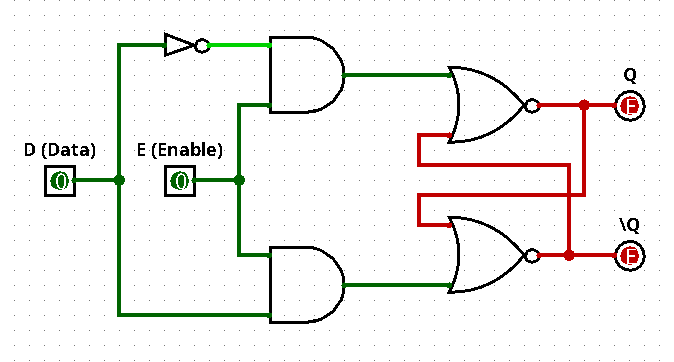
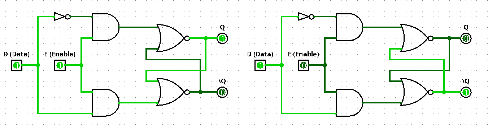
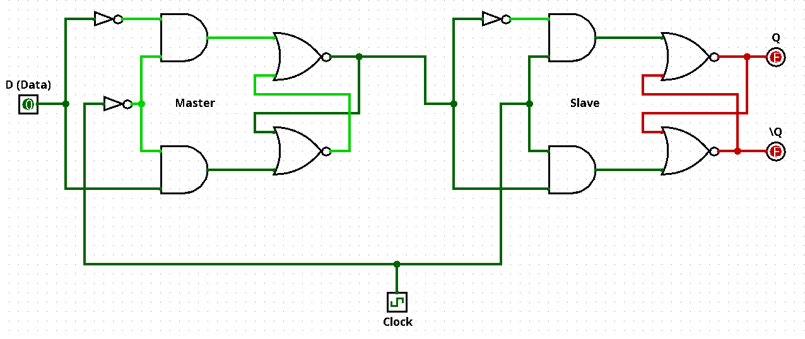
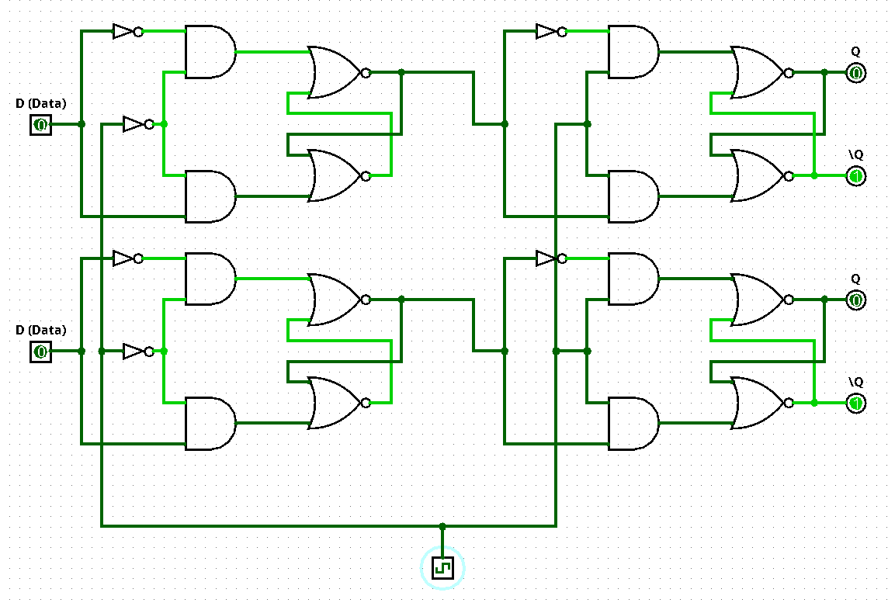

Um mecanismo de armazenamento é, essencialmente, qualquer circuito capaz de reter um estado lógico binário (0 ou 1) indefinidamente, desde que seja alimentado continuamente. Este é o conceito que separa a lógica combinacional da lógica sequencial, vista anteriormente.

Sabemos que, sem a realimentação, uma porta lógica dissipa sua saída assim que a entrada é alterada, pois a física do semicondutor apenas reflete a tensão de entrada nos transistores de saída.

Para exemplificarmos o conceito de realimentação positiva e como o armazenamento funciona, vamos ao seguinte exemplo: duas portas lógicas NOT onde a saída da primeira está diretamente ligada à segunda, fazendo com que a saída da segunda porta seja exatamente a entrada da primeira. Agora, se conectarmos a saída da segunda à entrada da primeira, teremos uma célula biestável, ou seja, um circuito que se realimenta mantendo seu estado. O par de inversores realimentados transforma a tensão transitória em uma retenção permanente de estado. Resumidamente, o resultado das entradas agora está armazenado dentro de um circuito fechado que está se realimentando e retendo o resultado indefinidamente.

## Latch SR (Set-Reset)

É um circuito de armazenamento binário assíncrono elementar. Ele resolve a limitação da célula biestável básica onde, utilizando o exemplo acima, temos uma espécie de "anel" com as portas lógicas NOT: como cada uma possui apenas uma entrada, torna-se impossível injetar um valor externo para ser utilizado. O Latch SR fornece pinos de entrada para gravar (set = 1), apagar (reset = 0) e manter o estado. Por ser assíncrono, não depende de sinal de clock, pois a saída reage imediatamente às entradas.

Para representar o circuito de um Latch SR, vamos utilizar duas portas NOR com duas entradas cada. Uma entrada de cada porta servirá para os valores de S e R, enquanto a outra entrada servirá para a conexão com a saída da outra porta.

 

> A imagem acima está representando um estado nulo; isso significa que nenhum valor foi aplicado ainda.

O circuito opera da seguinte forma: quando o botão de Set é acionado, ele envia um pulso rápido de nível alto (1) e retorna imediatamente para nível baixo (0). Esse pulso força a saída $Q$ para 1 e, mesmo após o botão voltar a 0, o circuito retém o dado e permanece nesse estado indefinidamente. Quando o botão de Reset é pressionado, o sistema executa a função contrária: força o valor de $Q$ de volta para 0 e, ao ser solto, mantém esse novo estado gravado. Esse comportamento decorre diretamente da natureza da porta NOR, cuja saída só é verdadeira (1) quando todas as suas entradas forem falsas (0). Em qualquer outra combinação, ela atua de forma inversora. Graças a essa característica combinada à realimentação positiva entre as duas portas, o circuito fecha um ciclo contínuo capaz de transformar pulsos transitórios em retenção permanente de estado. A saída complementar $\bar{Q}$ desempenha um papel fundamental nessa sustentação, como detalharemos adiante.

 

> Na imagem acima, à esquerda temos o botão Set pressionado e, à direita, o botão Reset pressionado.

O valor de $Q$, por exemplo, representa diretamente o estado operacional da máquina: quando o botão de Set é pressionado, a máquina liga ($Q = 1$); para desligá-la, pressiona-se o botão de Reset ($Q = 0$). Agora vamos a uma explicação importante sobre $\bar{Q}$: ele representa a oposição exata de $Q$ (sua saída complementar). Ele fornece um dado pronto que pode ser aproveitado de diferentes formas. Um exemplo prático seria um painel com duas lâmpadas indicadoras: verde para ligado e vermelha para desligado. Quando Set é pressionado, ele altera o valor de $Q$ para 1, alimentando o LED verde; com isso, $\bar{Q}$ vai a 0 e mantém o LED vermelho apagado. Quando Reset é acionado, $Q$ volta a 0 (apagando o verde) e, em contrapartida, o valor de $\bar{Q}$ vai imediatamente para 1, acendendo o LED vermelho para indicar que a máquina está em espera/desligada — tudo isso sem precisar gastar portas inversoras extras no circuito. Além dessa utilidade externa de sinalização contrária, $\bar{Q}$ tem uma função estrutural indispensável: ele é o nó intermediário do circuito que fecha o anel de realimentação. Sem o valor invertido de $\bar{Q}$ retornando para a porta de cima, o circuito não teria como manter $Q$ travado no valor correto quando os botões fossem soltos. Em condições normais de funcionamento, $Q$ e $\bar{Q}$ nunca assumem o mesmo valor simultaneamente: se um é 1, o outro é obrigatoriamente 0. O exemplo acima é uma forma direta e prática de enxergar o funcionamento do Latch SR e a razão de ser de suas entradas e saídas.

Apesar de tudo isso, o grande problema do Latch SR é a condição proibida (ou estado inválido), que ocorre quando as entradas S e R recebem 1 ao mesmo tempo. Pela regra, $Q$ e $\bar{Q}$ sempre devem ser opostos. Retornando ao exemplo da máquina: se ambos recebessem entradas iguais a 1, isso significaria que tanto o LED verde (ligado) quanto o LED vermelho (desligado) apagariam ao mesmo tempo, gerando um estado ilógico no circuito.

O pior acontece quando as duas entradas são zeradas ao mesmo tempo (de 1 para 0). As duas portas NOR tentam mudar as saídas para 1 simultaneamente. Esse valor 1 sai de cada porta e entra na outra pela linha de realimentação. Quando o 1 chega na entrada oposta, ele força a outra porta de volta para 0. Esse ciclo vicioso faz o circuito entrar em uma condição de corrida (*race condition*): as portas começam a disputar entre si quem estabiliza primeiro.

No mundo real, fatores imperceptíveis como ruído térmico, comprimento de trilhas ou pequenas diferenças de milissegundos nos transistores decidem qual porta "ganha" a briga. O resultado final após soltar os botões torna-se completamente aleatório e imprevisível: você não tem controle se a máquina vai ficar ligada ou desligada.

 

> Na imagem acima é exibido o comportamento do circuito no programa Logisim. A tentativa de transição simultânea para 0 faz com que ambas as portas tentem ir para 1 ao mesmo tempo, gerando um conflito de realimentação e indefinição no circuito.

---

## Latch D (Transparent Latch)

É uma evolução do Latch SR projetada para resolver dois problemas centrais: eliminar a condição proibida do Latch SR, que causava inconsistência lógica, e adicionar um controle de escrita temporal por meio de um pino de controle chamado Enable. Essa adição garante que o circuito não fique suscetível a alterações de dados a qualquer momento, aceitando novos valores apenas quando o pino de controle autorizar.

A construção do Latch D utiliza a mesma estrutura do Latch SR como base e adiciona mais duas portas AND e uma porta NOT, tornando possível realizar o controle dos valores de entrada.

 

Observe que agora temos as entradas D (*Data*) e E (*Enable*). A entrada D recebe o bit binário a ser armazenado, enquanto a entrada E atua como pino de autorização; ou seja, o valor de D só é transferido para o circuito de memória quando o pino E estiver ativo (nível lógico 1). 

Para compreender melhor como essa construção opera, note que temos duas portas AND, cada uma conectada a uma das entradas das portas NOR. Pela tabela verdade da porta AND, a saída só será 1 se ambas as entradas forem 1, e é exatamente aí que atua o pino de autorização, ligado a ambas as portas AND simultaneamente. Assim, mesmo que a entrada D esteja ativa, o valor só alcança o circuito de armazenamento se E permitir. 

Por sua vez, a porta NOT inserida na entrada de uma das portas AND garante que sinais com o mesmo nível lógico nunca sejam injetados ao mesmo tempo nas entradas NOR, eliminando em definitivo a condição proibida do Latch SR.

### O Conceito de Transparência

O termo *Transparent Latch* (trava transparente) vem do comportamento do circuito quando o pino Enable está em nível alto (`E = 1`):

* **Modo Transparente (`E = 1`):** Enquanto a entrada de controle estiver ativa, o circuito atua como uma "janela aberta". Qualquer alteração feita na entrada D reflete-se imediatamente na saída Q em tempo real. Se o valor de D oscilar, Q oscila junto instantaneamente, como se o circuito fosse invisível (transparente) para o sinal.
* **Modo de Memória / Trava (`E = 0`):** No momento exato em que o pino Enable vai para 0, a "janela fecha". A saída Q trava e retém o último valor que estava presente em D antes do bloqueio. A partir desse instante, qualquer alteração na entrada D é completamente ignorada, garantindo o armazenamento estático do dado.

 

---

## Flip-Flops e Registradores

### Flip-Flop

É um elemento de memória binária síncrono e disparado por borda (*edge-triggered*). Ele armazena exatamente 1 bit, mas, diferentemente do Latch D, ele não é transparente. De acordo com a arquitetura clássica, um Flip-Flop é exatamente a união de dois Latches operando em conjunto, controlados de forma defasada por um Clock.

Dizer que ele é disparado por borda significa que, em vez de responder a um nível contínuo de sinal (como o Enable do Latch D), o Flip-Flop só atualiza a sua saída no instante exato da transição do sinal de sincronismo (Clock). As duas definições são:
- Borda de subida (*rising edge* / transição de 0 para 1);
- Borda de descida (*falling edge* / transição de 1 para 0).

Durante o restante do ciclo, independentemente de o Clock estar em nível alto ou baixo, as entradas são ignoradas e a saída $Q$ permanece imutável. De maneira mais simples, o Flip-Flop trabalha em sincronia com o Clock, e o valor de $Q$ só é alterado no momento exato da transição do sinal.

Vamos a um exemplo com um Flip-Flop tipo D disparado por borda e utilizando o componente de Clock. A arquitetura padrão para criar sensibilidade estrita à borda chama-se Flip-Flop D Mestre-Escravo (*Master-Slave*): conectamos dois Latches D em série, com os sinais de Clock invertidos entre eles.

 

>Veja que o Estágio Mestre recebe o sinal de Clock invertido ($\overline{Clk}$), enquanto o Estágio Escravo recebe o sinal direto do Clock.

Enquanto o Clock estiver em nível baixo (0), mesmo que seja aplicado um novo valor em D, a saída $Q$ não se alterará, pois o Escravo está travado. No instante exato em que o Clock transita de $0 \to 1$ (Borda de Subida), o Mestre trava imediatamente o valor presente em D, e no mesmo microssegundo o Escravo abre e transfere esse dado congelado para a saída final $Q$. Em outras palavras, a saída $Q$ só é atualizada no instante em que o Clock transita de 0 para 1 (Borda de Subida); na transição contrária (de 1 para 0), a saída permanece inalterada.

<video src="./imgs/flipflopDvideo.mp4" controls width="100%"></video>

 

---

## Registradores

Um registrador é uma estrutura de memória extremamente rápida, compacta e de mais baixo nível em um sistema digital. Ele reside no topo da hierarquia de memória, situado diretamente dentro do processador (CPU), ao lado da Unidade Lógica e Aritmética (ULA) e da Unidade de Controle.

Estruturalmente, um registrador é um arranjo de $N$ Flip-Flops dispostos em paralelo, onde cada Flip-Flop é responsável por armazenar exatamente 1 bit.

- Um registrador de 4 bits utiliza 4 Flip-Flops.

- Um registrador de 8 bits (1 byte) utiliza 8 Flip-Flops.

- Os registradores de arquiteturas modernas (x86-64, ARM64) contêm 64 bits, ou seja, conjuntos paralelos de 64 Flip-Flops.

Os Flip-Flops do registrador compartilham o mesmo sinal de Clock, recebendo exatamente a mesma linha de temporização de forma simultânea. Isso torna qualquer operação de leitura ou escrita perfeitamente atômica e sincronizada, garantindo que todos os bits da palavra binária sejam capturados ou transferidos no mesmo instante.

Mesmo que a memória RAM seja rápida, ela permanece fora do chip da CPU. Acessar a RAM exige trafegar dados por barramentos físicos externos, gerando uma latência de centenas de ciclos de Clock (o chamado *Memory Wall*). Os registradores existem para eliminar esse gargalo, servindo como um espaço de trabalho imediato para a CPU, já que residem no próprio núcleo do processador.

 

> A imagem acima representa um registrador simples de 2 bits formado por dois Flip-Flops D em paralelo.

Agora vamos a um exemplo prático: imagine que o processador precise executar uma operação trivial como somar dois números, por exemplo, 5 mais 3. Como a memória RAM principal fica distante do núcleo de processamento e possui um tempo de resposta lento, a CPU não calcula nada diretamente dentro dela; em vez disso, ela busca o número 5 na RAM e o grava dentro de um registrador interno chamado A (um conjunto de Flip-Flops), e busca o número 3 gravando-o em um segundo registrador chamado B. Com esses dois valores já retidos internamente em seus próprios Flip-Flops na velocidade máxima do chip, a Unidade Lógica e Aritmética (ULA) lê os bits dos registradores A e B sem intermediários, calcula a soma 8 em um único pulso de clock e armazena esse resultado imediatamente em um terceiro registrador de destino, o registrador C. Somente após essa etapa relâmpago entre registradores é que a CPU decide se mantém o número 8 ali para a próxima operação matemática imediata ou se finalmente o envia de volta para ser persistido na memória RAM.

Em suma, a evolução do armazenamento digital ocorre de uma forma hierarquia: portas lógicas básicas cruzadas originam os **Latches** (memória sensível a nível); o encadeamento defasado de dois Latches via Clock dá origem aos **Flip-Flops** (memória síncrona disparada por borda); e o agrupamento paralelo desses Flip-Flops sob uma mesma linha de temporização forma os **Registradores**, os blocos fundamentais que fornecem à CPU velocidade imediata para coordenar e executar qualquer instrução de máquina.

---

## Estrutura interna da memória RAM

Um registrador funciona muito bem para um baixo uso de memória ( como 8, 32 ou 64 bits), mas em escala maiores, na casa dos gigabytes, seriam necessários centenas de bilões de transistores, o que geraria um enorme custo financeiro e consumo térmico inviável. A memória RAM (Random Access Memory) resolve este problema através de duas grandes mudanças de paradigma:

- O conceito de "Acesso Aleatório": Qualquer byte pode ser lido ou escrito no mesmo intervalo de tempo, independentemente de sua posição física, usando um sistema de endereçamento numérico.
- Organização em Matriz Bidimensional: Em vez de manter fios individuais de controle para cada bit, as células de memória são organizadas em uma grade de Linhas e Colunas.

Podemos dividir a memória RAM em duas técnologias, a depender de como o bot físico será armazenado:

- **SRAM (RAM Estática):** é extremamente rápida e é usada em memórias Cache (L1. L3, L3) localizadas dentro da própria CPU. Porém, é um tipo de memória muito cara.
- **DRAM (RAM Dinâmica):** é a memóra RAM principal do computador (como módulos DDR$, DDR5). São bem mais baratas e densas, porém possui uma latência bem maior.

O grande problema da DRAM são os capacitores microscópicos que perdem sua carga elétrica através do silício em milissegundos. Por isso, a memória precisa de um circuito que lê e reescreve cada célula repetidamente dezenas de vezes por segundo (o ciclo de Refresh). Se não houver refresh, a memória "esquece" o dado.

A memória RAM funciona com uma lógica de acesso direto: ela usa endereços binários para encontrar qualquer dado no mesmo intervalo de tempo, sem precisar percorrer a memória de forma sequencial. O que realmente muda entre os tipos de RAM é a velocidade, a tecnologia de armazenamento e o local onde cada uma fica instalada no computador.

A SRAM utiliza portas lógicas e transistores organizados de forma biestável (como vimos na estrutura dos Latches), mantendo o dado armazenado de forma contínua enquanto o circuito estiver energizado. Já a DRAM utiliza apenas um transistor e um capacitor minúsculo por bit. Por ser um capacitor físico, a carga elétrica vaza em poucos milissegundos, exigindo que o circuito faça ciclos repetidos de recarga chamados de Refresh para não perder a informação.

Internamente, a memória RAM é dividida em quatro partes principais:

- **Matriz de células (Grade 2D):** Em vez de usar milhões de fios lineares, as células são dispostas em linhas e colunas cruzadas, onde cada cruzamento armazena 1 bit.

- **Decodificadores de endereço:** Circuitos que recebem o endereço binário enviado pela CPU e ativam a linha horizontal (wordline) e a coluna vertical (bitline) correspondentes àquele dado.

- **Amplificadores de sinal (Sense Amplifiers):** Circuitos responsáveis por identificar as pequenas variações elétricas que saem das células e convertê-las em níveis lógicos 0 ou 1 estáveis.

- **Linhas de controle:** Pinos que definem se a operação naquele instante será de leitura ou de gravação (como o sinal de Write Enable).

O processo de acesso acontece de forma coordenada. Quando a CPU precisa de um dado, ela coloca o endereço no barramento. O decodificador de linha ativa a wordline, abrindo o acesso às células daquela linha inteira. Em seguida, as cargas descem pelas linhas verticais até os amplificadores, e o decodificador de coluna seleciona exatamente o byte solicitado para enviar pelo barramento de dados. No caso da escrita, o caminho é o mesmo, mas o circuito injeta a tensão necessária para forçar o novo valor para dentro da célula.

No funcionamento prático do computador, a CPU utiliza essas memórias de forma complementar:

- **Armazenamento na DRAM (RAM Principal):** É onde ficam os programas, o sistema operacional e os dados pesados abertos no momento. Ela fica nos pentes externos da placa-mãe porque tem um custo menor e permite ter muitos gigabytes de espaço.

- **Armazenamento na SRAM (Memória Cache):** Fica integrada diretamente dentro do encapsulamento da CPU (L1, L2 e L3). Como acessar a DRAM externa custa dezenas de ciclos de clock, o controlador de hardware copia automaticamente os blocos de dados mais usados da DRAM para a SRAM. Assim, a CPU consegue ler e escrever dados quase que instantaneamente, recorrendo à DRAM externa apenas quando o dado solicitado não está na Cache.