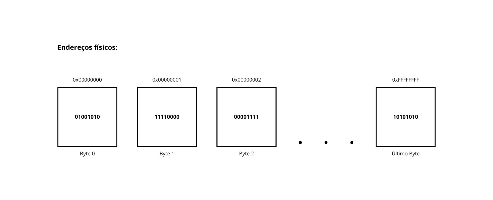

## Endereçamento Físico

Para que o processador possa executar qualquer instrução, é necessário buscar ou gravar informações em um local exato. A forma como a CPU localiza fisicamente cada pedaço de informação e a infraestrutura elétrica usada para transportar esses dados definem o endereçamento físico e a largura dos barramentos.

A memória RAM funciona como um armário gigantesco, onde cada compartimento guarda exatamente 1 byte (8 bits) de informação. Este é o conceito de memória endereçável por byte (*byte-addressable memory*). Cada compartimento possui um identificador numérico único e sequencial: o Endereço Físico.

O endereço físico é o valor binário real gerado no hardware para apontar a célula de silício específica dentro dos módulos de memória. Veja a representação abaixo:

 

Observe na imagem que o endereço de memória está representado em hexadecimal. Isso ocorre porque, nativamente, os computadores operam em binário (base 2). Um endereço de memória moderno de 64 bits requer 64 caracteres de zeros e uns, o que se torna inviável para humanos lerem ou depurarem.

O sistema hexadecimal (base 16) é utilizado por conta do seu alinhamento perfeito com o sistema binário: $16 = 2^4$, ou seja, cada dígito hexadecimal converte-se exatamente em um bloco de 4 bits (um *nibble*). Consequentemente, 1 byte é representado por exatamente 2 caracteres hexadecimais.

> O prefixo `0x` não faz parte do valor hexadecimal em si; ele é utilizado apenas como uma convenção de sintaxe criada para que compiladores, interpretadores e programadores saibam que aquele número deve ser interpretado na base 16.

Veja a comparação entre um endereço de memória binário de 32 bits e o mesmo endereço em hexadecimal:

- **Binário:** `0b01111111111111011111100010111100`
- **Hexadecimal:** `0x7FFDF8BC`

---

### Barramentos

A CPU se comunica com a memória através dos barramentos, que são trilhas metálicas condutoras na placa-mãe interligando o processador aos demais componentes do sistema. Essas pistas elétricas são divididas em três barramentos essenciais:

- **Barramento de Endereço (*Address Bus*):** É unidirecional (da CPU para a memória e periféricos). O processador coloca nos condutores desse barramento os níveis de tensão correspondentes aos bits do endereço que deseja acessar para leitura ou escrita.

- **Barramento de Dados (*Data Bus*):** É bidirecional. Uma vez que o endereço é selecionado, o conteúdo dos dados trafega por aqui: da memória para a CPU (leitura) ou da CPU para a memória (escrita).

- **Barramento de Controle (*Control Bus*):** Transporta sinais de sincronização e comando (ex.: sinal de clock, linha de leitura `READ`, linha de escrita `WRITE`, pedidos de interrupção e confirmações de barramento).

A largura do barramento corresponde ao número de condutores físicos paralelos que ele possui. Cada linha elétrica transporta apenas um estado binário: nível alto de tensão (1) ou nível baixo de tensão (0). A largura do barramento de endereço determina matematicamente a capacidade máxima de memória física que o processador consegue endereçar diretamente. Se um processador possui um barramento de endereços de $n$ bits de largura, o número total de endereços únicos que ele consegue gerar é igual a $2^n$.

Por exemplo, um barramento de endereços de 32 bits ($2^{32}$) consegue endereçar 4.294.967.296 bytes. Como cada endereço aponta para 1 byte, isso resulta em exatamente 4 GiB (aproximadamente 4 GB). Isso significa que um processador com barramento de endereço limitado a 32 bits enxerga, no máximo, 4 GB de espaço físico de memória.

Atualmente, as arquiteturas padrão de mercado operam em 64 bits. O número teórico de endereços possíveis torna-se monumental:

$$2^{64} = 18.446.744.073.709.551.616 \text{ bytes} = 16 \text{ Exabytes (EB)}$$

> Na prática de engenharia, construir barramentos e circuitos com 64 linhas de pinos físicos dedicadas exclusivamente ao endereçamento externo encarece absurdamente o encapsulamento do processador e o projeto das placas-mãe sem necessidade imediata. Por isso, os processadores modernos x86-64 implementam barramentos físicos reais que variam entre 48 e 52 bits, permitindo endereçar diretamente de 256 Terabytes a até 4 Petabytes de RAM física, o que atende com ampla folga os servidores e desktops atuais.

Enquanto o barramento de endereço define **onde e quanto** a CPU acessa, a largura do **Barramento de Dados** define o **volume de transferência de dados por ciclo de clock**:

- Em barramentos de dados de 32 bits (4 bytes), a cada ciclo de leitura na memória, trafegam 4 bytes simultaneamente pelos condutores elétricos.
- Em barramentos de dados de 64 bits (8 bytes), trafegam 8 bytes (uma "palavra dupla quádrupla" ou *quadword*) por pulso de barramento.

---

### Alinhamento de Memória (*Memory Alignment*)

O barramento de dados não lê a memória a partir de qualquer byte arbitrário sem custo de desempenho; ele opera em blocos naturalmente alinhados à sua largura (múltiplos de 4 ou 8 bytes). Isso significa que o hardware acessa a memória em blocos regulares de 4 em 4 bytes (em barramentos de 32 bits) ou de 8 em 8 bytes (em barramentos de 64 bits).

Quando você declara uma variável de 8 bytes em um endereço desalinhado (por exemplo, no endereço `0x0003` em vez de uma fronteira alinhada como `0x0000` ou `0x0008`), o valor fica dividido entre duas linhas consecutivas de barramento. Nesse cenário, o hardware precisa disparar dois acessos separados à memória RAM, aplicar operações de deslocamento binário (*bit shifting*) e mascaramento lógico (*OR/AND*) para recompor o número original, degradando o desempenho de execução.

De forma prática, o hardware precisa ler primeiro o bloco alinhado entre `0x0000` e `0x0007` (onde se encontram os primeiros 5 bytes da sua variável) e, em seguida, disparar um segundo ciclo de leitura no bloco entre `0x0008` e `0x000F` (onde residem os 3 bytes restantes).

Com as duas palavras carregadas, a CPU precisa realizar operações lógicas internas (`SHIFT` e `OR`) para concatenar os 5 bytes da primeira leitura com os 3 bytes da segunda, montando os 8 bytes finais dentro do registrador de destino.

> Em certas arquiteturas estritas de conjunto de instruções (como versões clássicas de ARM ou MIPS), o processador sequer efetua essa recomposição automática por padrão: ao tentar ler um dado desalinhado, a CPU interrompe a instrução e dispara uma exceção de hardware de falha de alinhamento (*Alignment Fault* ou *Bus Error*).

É por essa razão física que compiladores de linguagens de baixo nível (como C e C++) adicionam automaticamente bytes invisíveis de preenchimento (*padding*) entre os campos de uma `struct`, garantindo que cada membro fique posicionado em um endereço que coincida com a sua fronteira natural de alinhamento e com a largura dos barramentos do sistema.

---

### Mapeamento de Memória

Em uma arquitetura de computadores completa, o processador não interage apenas com a memória RAM; ele precisa se comunicar com periféricos essenciais, como placa de vídeo, controladoras NVMe/SATA, interfaces de rede, portas USB e temporizadores. O processador precisa de um mecanismo para enviar comandos e transferir dados para esses circuitos. Historicamente, existem duas abordagens fundamentais:

#### Port-Mapped I/O (PMIO)

É uma arquitetura em que a CPU mantém um espaço de endereçamento totalmente separado, isolado e paralelo para os dispositivos periféricos, distinto do mapa de endereçamento da memória RAM. O processador disponibiliza instruções específicas do conjunto de instruções (como `IN` e `OUT` no x86) dedicadas unicamente a ler e escrever nessas portas de entrada e saída.

Embora essa separação protegesse os escassos kilobytes de RAM dos primeiros computadores contra o consumo por periféricos, o PMIO tornou-se um modelo legado e menos flexível. Ele cobra um custo alto em desempenho: o tráfego fica tipicamente afunilado nos registradores acumuladores (`AL`/`AX`/`EAX`), não oferece suporte aos modos avançados de indexação por ponteiros comuns e possui um limite restrito de apenas 64 KB de espaço de portas de I/O, tornando inviável atender periféricos modernos de altíssima vazão, como placas de vídeo e adaptadores de rede de alta velocidade.

> O processador emblemático que consolidou essa abordagem na linha pessoal foi o Intel 8086, lançado em 1978.

#### Memory-Mapped I/O (MMIO - Entrada/Saída Mapeada em Memória)

É o padrão dominante nos sistemas computacionais contemporâneos. Nessa abordagem, a placa-mãe reserva faixas dedicadas do próprio mapa de endereçamento físico e as associa diretamente aos registradores e *buffers* dos dispositivos periféricos, em vez de conectá-las a chips de memória RAM.

Cada dispositivo conectado à placa-mãe (como placas de vídeo, placas de rede ou controladoras NVMe via barramento PCI Express) possui circuitos integrados próprios contendo pequenos registradores de configuração padronizados, conhecidos como **BAR (*Base Address Registers*)**.

Durante a inicialização do computador, o firmware do sistema (BIOS/UEFI) executa o procedimento de enumeração dos barramentos:
1. Lê os registradores BAR de cada componente para identificar quanto espaço contíguo de endereçamento aquele circuito precisa para expor seus *buffers* e registros de controle.
2. Atribui e grava diretamente no BAR de cada periférico o endereço físico base pelo qual ele passará a responder no barramento do sistema.
3. Configura os controladores centrais (como o *Root Complex* do barramento PCI Express) com essas faixas em suas tabelas de decodificação interna.

Dessa forma, o processador não precisa de instruções especiais: para alterar uma configuração da placa de vídeo ou enviar um comando a um controlador de rede, ele executa uma instrução comum de escrita em memória (como `MOV` em Assembly ou a desreferência de um ponteiro em C). Quando o ciclo do barramento é disparado, o decodificador de endereços detecta que a faixa pertence a um dispositivo periférico e desvia os sinais do canal da RAM física diretamente para o barramento PCIe.

Para o sistema operacional organizar essa distribuição sem conflitos, entra em ação o padrão **ACPI (*Advanced Configuration and Power Interface*)**. O processador opera lidando puramente com valores numéricos de endereços físicos, sem consciência prévia de onde começa a RAM ou onde termina um dispositivo integrado. O firmware da placa-mãe fornece ao sistema operacional tabelas descritivas de hardware, entre as quais se destaca a **DSDT (*Differentiated System Description Table*)**, que funciona como uma verdadeira "planta baixa" dos circuitos da placa-mãe. 

A relação direta entre a DSDT e o MMIO reside na arbitragem do espaço de endereçamento: enquanto o MMIO define o método elétrico e lógico de acessar dispositivos periféricos através do mapa de endereços, a DSDT define formalmente, por meio de estruturas de descrição de recursos, como o `_CRS` (*Current Resource Settings*), quais janelas exatas de endereços físicos as pontes de barramento (*host bridges* do PCIe) estão autorizadas a reivindicar e repassar aos periféricos, garantindo que o sistema operacional jamais tente alocar páginas comuns de RAM sobre áreas reservadas para a comunicação de hardware.