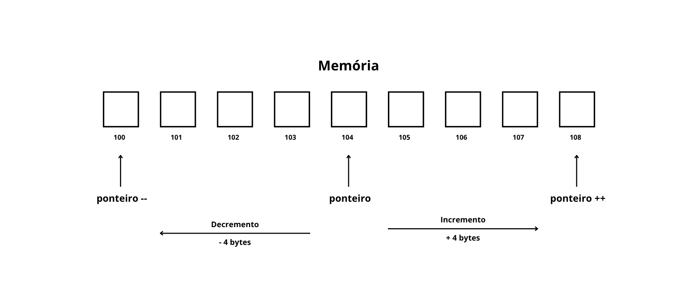

## Manipulação de memória em baixo nível

> Nesta seção, utilizaremos a linguagem C para exemplificar esses conceitos, aproveitando sua proximidade com a arquitetura de hardware e a manipulação direta de memória.

### Memória Virtual

Antes de entrarmos no campo da manipulação de memória de baixo nível, precisamos compreender um mecanismo indispensável para a estabilidade e a segurança de qualquer sistema moderno: a Memória Virtual.

Em sistemas operacionais contemporâneos, nenhum programa em execução acessa a memória RAM física diretamente. Se os processos operassem sob endereçamento físico direto, enfrentaríamos uma ausência completa de segurança e isolamento. Caso um Programa A gravasse dados no endereço `0x1000` e um Programa B escrevesse no mesmo local, teríamos corrupção imediata de memória, perda de dados confidenciais (como senhas e chaves criptográficas) e até brechas para injeção de código malicioso. Seria um cenário caótico, onde uma aplicação instável poderia facilmente derrubar o sistema inteiro.

Para neutralizar esse problema, a memória virtual cria uma abstração elegante: cada processo opera sob a ilusão de que é o único dono de todo o computador. Toda aplicação recebe um Espaço de Endereçamento Virtual (Virtual Address Space) amplo, contínuo e estritamente isolado, iniciando virtualmente no endereço `0x0` e estendendo-se por toda a amplitude suportada pela arquitetura (em x86_64, tipicamente uma faixa de 48 bits, concedendo até 256 Terabytes teóricos por processo). Assim, mesmo que dois programas utilizem exatamente o mesmo endereço numérico de memória, não há colisão: cada endereço virtual aponta, nos bastidores, para células físicas completamente distintas dentro da RAM.

Essa mecânica não funciona puramente por software (o que tornaria o sistema inviável por lentidão) e nem puramente por hardware (que não possui a inteligência das políticas de processos). Ela opera como uma simbiose precisa entre a MMU (Memory Management Unit) e o Kernel do Sistema Operacional:

- **A MMU (Hardware):** É um circuito integrado localizado dentro da própria CPU, posicionado estrategicamente entre os núcleos de processamento e os canais de memória. Ela intercepta todas as instruções de leitura e escrita emitidas pelo processador, converte endereços virtuais em físicos em frações de nanosegundos e valida permissões de acesso em tempo real, bloqueando eletricamente qualquer tentativa de gravar em regiões protegidas ou de executar dados em áreas não autorizadas.
- **O Kernel (Software):** Atua como o estrategista central. Ele organiza a memória por meio da paginação (paging), dividindo tanto o espaço virtual quanto a RAM física em blocos de tamanho fixo (geralmente de 4 KB), chamados respectivamente de páginas virtuais e molduras de página (page frames). O kernel constrói e atualiza na própria RAM as Tabelas de Páginas (Page Tables), informando à MMU onde encontrar essas tabelas a cada troca de contexto entre processos (através de registradores de controle da CPU, como o `CR3` no x86). Além disso, cabe ao kernel interceptar falhas sinalizadas pela MMU, os chamados page faults, permitindo alocar memória sob demanda ou encerrar processos que cometem violações de acesso (segmentation fault).

Em suma, a memória virtual transforma o caos do hardware compartilhado em um ambiente previsível, seguro e determinístico. Ela liberta o desenvolvedor da preocupação sobre onde exatamente suas variáveis estão no silício da RAM, permitindo que múltiplos programas coexistam em perfeita harmonia, cada um confinado em seu próprio universo digital.

### Ponteiros e Aritmética de Ponteiros

Um ponteiro é uma variável comum cujo valor armazenado é um endereço de memória. Em arquiteturas de 32 bits, qualquer ponteiro ocupa 4 bytes; em arquiteturas de 64 bits, ocupa 8 bytes, independentemente de apontar para um simples `char` (1 byte) ou para uma `struct` gigantesca. Isso ocorre porque o ponteiro não guarda os dados em si, mas apenas a coordenada inicial (o endereço base) onde o dado começa.

Para manipular essas posições de memória, existem dois operadores fundamentais:

* **Operador de Endereço (`&`):** Obtém a coordenada (o endereço de memória virtual) onde uma variável está alocada.
* **Operador de Desreferência (`*`):** Acessa o endereço armazenado no ponteiro, instruindo a CPU a ler ou alterar os bytes guardados naquela posição.

```C
int valor = 42;
int *ptr = &valor; // ptr guarda o endereço de 'valor' (ex: 0x7FFF0010)

printf("Valor: %d\n", *ptr);      // Imprime 42 (desreferência)
printf("Endereço: %p\n", (void*)ptr); // Imprime 0x7FFF0010
```

A partir disso, surge a **aritmética de ponteiros**, que é a forma como navegamos pelos blocos de memória contíguos (como em vetores). Diferente da aritmética comum, somar 1 a um ponteiro não significa avançar apenas 1 byte; a CPU avança o tamanho exato do tipo de dado apontado. Se tivermos um ponteiro para `int` (que ocupa 4 bytes), somar 1 fará o ponteiro saltar 4 bytes à frente, alcançando perfeitamente o próximo elemento.

Em termos práticos, a CPU calcula o deslocamento pela seguinte equação:

$$\text{Novo Endereço} = \text{Endereço Base} + (n \times \text{sizeof(Tipo)})$$



</br>

É exatamente por esse mecanismo que os índices de vetores começam em zero: acessar `vetor[0]` significa aplicar um deslocamento nulo ($n = 0$), acessando imediatamente o endereço base sem realizar cálculos adicionais.

### Segmentação de Memória: Stack e Heap

Quando o sistema operacional carrega um executável na memória, ele cria um espaço de endereçamento virtual dividido em segmentos bem definidos:

| Segmento | Papel Técnico |
| :--- | :--- |
| **Text Segment** | Contém o código binário (instruções de máquina). É somente leitura para evitar automodificação acidental. |
| **Data / BSS** | Variáveis globais e estáticas. O *Data* armazena as inicializadas; o *BSS* reserva espaço para as variáveis não inicializadas (zeradas). |
| **Heap (Monte)** | Memória para alocação dinâmica sob demanda em tempo de execução. |
| **Stack (Pilha)** | Memória estruturada para controle de fluxo, chamadas de funções e variáveis locais. |

#### Stack

A Stack opera no modelo LIFO (*Last In, First Out*), ou seja, o último a entrar é o primeiro a sair. Toda vez que uma função é chamada, a CPU empilha um bloco de dados chamado *Stack Frame* (quadro de pilha). A Stack é gerenciada diretamente pelo processador por meio de registradores específicos, como o RSP (*Stack Pointer*) e o RBP (*Base Pointer*).

É extremamente rápido alocar variáveis na Stack, custando muitas vezes apenas 1 ciclo de clock (basta subtrair o valor necessário do registrador RSP, já que a pilha cresce para baixo). Seu ciclo de vida é estritamente automático, determinado pelo encerramento do escopo ou pelo comando `return` de uma função. O tamanho da pilha é fixo e restrito (no Linux, o padrão do kernel geralmente é de 8 MB). Tentar criar arrays gigantescos na pilha ou entrar em uma recursão infinita estoura esse limite, gerando o erro fatal de *Stack Overflow* (que resulta em um *Segmentation Fault*).

De maneira resumida, quando você declara uma variável local comum dentro de uma função, ela é armazenada na Stack, e o próprio hardware (junto ao código gerado pelo compilador) fica responsável pelo seu ciclo de vida.

#### Heap

A Heap é uma área aberta e flexível da memória virtual destinada a dados cujo tamanho ou tempo de vida não podem ser determinados durante a compilação. Neste caso, a CPU não controla essa área por registradores automáticos de pilha. Quem gerencia esse espaço é um algoritmo alocador de memória (*Memory Allocator*, como o *ptmalloc* da GNU libc no Linux).

O ciclo de vida dos dados alocados na Heap é definido exclusivamente pelo programador. Um bloco alocado na Heap permanece ativo na RAM até ser explicitamente liberado ou até o processo inteiro ser encerrado pelo sistema operacional. A Heap é bem mais lenta que a Stack: para entregar memória, o alocador precisa percorrer estruturas internas de blocos livres, lidar com a fragmentação de memória e, quando o espaço pré-alocado se esgota, emitir chamadas de sistema (*syscalls*, como `brk` ou `mmap`) para requisitar novas páginas de memória ao kernel do Linux.

Em linguagens como C, o controle da Heap está sob total responsabilidade do desenvolvedor por meio de funções da biblioteca padrão, como `malloc`, `calloc`, `realloc` e `free`. A vantagem dessa abordagem é o máximo desempenho e o controle cirúrgico do consumo de recursos. Porém, o mau uso da alocação dinâmica traz perigos graves:

- **Memory Leak (Vazamento de Memória):** Ocorre quando você perde o ponteiro que referenciava um bloco alocado na Heap sem antes invocar `free()`. Essa memória continua marcada como em uso indefinidamente, podendo esgotar a RAM do computador ao longo do tempo.
- **Dangling Pointer (Ponteiro Solto/Órfão):** Ocorre quando você executa `free(ptr)`, liberando o bloco, mas continua tentando acessar ou modificar o endereço por meio de `*ptr`. Como aquela região pode ser redistribuída pelo alocador para outras finalidades, o acesso indevido corrompe dados silenciosamente.
- **Double Free:** Trata-se da tentativa de chamar `free()` duas vezes para o mesmo endereço de memória sem uma nova alocação intermediária. Isso corrompe as tabelas internas do alocador e faz com que o sistema operacional encerre o processo imediatamente por motivos de segurança (gerando uma interrupção `SIGABRT` no Linux).

### Garbage Collector (GC)

O *Garbage Collector* (coletor de lixo) é um mecanismo automatizado de gerenciamento de memória presente em várias linguagens modernas (como Java, C#, Go, JavaScript e Python). Sua função principal é rastrear, identificar e desalocar automaticamente da Heap os blocos de memória que não possuem mais nenhuma referência ativa no código, devolvendo esse espaço para o alocador interno do *runtime* ou para o sistema operacional.

Existe quem confunda o *Garbage Collector* com a própria Stack por ambos envolverem automação, mas a atuação é totalmente distinta: a Stack é liberada diretamente pela mecânica de execução do hardware ao sair de uma função, enquanto o *Garbage Collector* atua monitorando os objetos alocados na Heap. Em linguagens gerenciadas, ao instanciarmos objetos ou arrays dinâmicos sem tamanho fixo, o ambiente aloca a estrutura na Heap e delega ao GC a responsabilidade de monitorar suas referências e liberar a memória no momento propício.

Embora o *Garbage Collector* evite falhas críticas de segurança e vazamentos triviais, ele impõe concessões arquiteturais importantes:

- **Pausas na Execução (*Stop-the-World*):** Em certos pontos da coleta, o ambiente de execução precisa paralisar temporariamente as *threads* da aplicação para inspecionar os grafos de objetos e referências de forma consistente, garantindo que ponteiros não sejam movidos ou alterados enquanto são avaliados. Mesmo com coletores modernos focados em baixa latência, pequenas pausas ainda acontecem.
- **Maior Consumo de RAM:** Ambientes com memória gerenciada costumam consumir consideravelmente mais RAM do que implementações equivalentes em linguagens manuais como C ou Rust. Isso ocorre porque o coletor necessita de uma margem substancial de espaço livre na Heap para operar com eficiência e evitar coletas constantes a cada pequena alocação.
- **Não Determinismo:** O desenvolvedor não tem controle exato sobre o instante preciso em que a memória será varrida e liberada. Para sistemas de tempo real estrito (como controladores industriais, sistemas críticos de frenagem, drivers de baixo nível ou motores de áudio com exigência de latência mínima), essa imprevisibilidade temporal costuma inviabilizar o seu uso.

Em linguagens de alto nível voltadas para produtividade web e corporativa, a coleta automática consolidou-se como o padrão da indústria. Contudo, em programação de sistemas, infraestrutura e sistemas operacionais, a manipulação direta e manual da memória continua indispensável pela previsibilidade e eficiência que oferece.